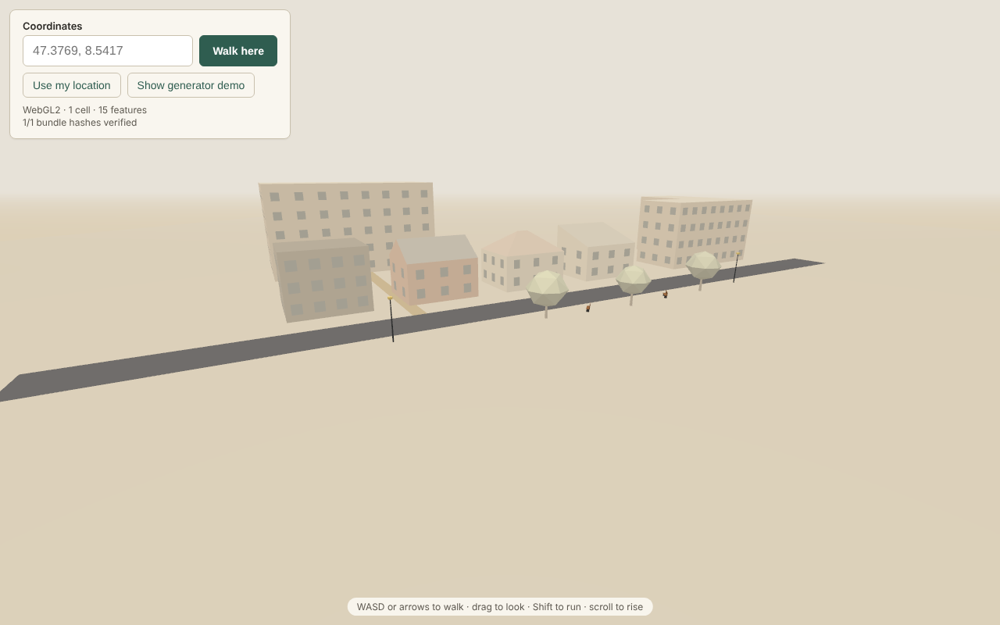
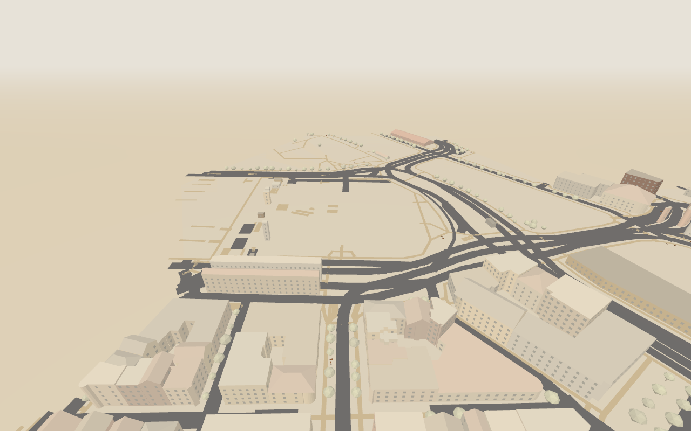

# Otherhere

A second version of where you already are: your real place, but playable, imagined, and shared. The whole Earth starts as a stylized sketch and sharpens wherever someone plays, captures, or pays attention. It's a game first, not a digital twin.

Read [`docs/BRIEF.md`](docs/BRIEF.md) for the vision, [`docs/notes/model-field-notes.md`](docs/notes/model-field-notes.md) for what we've learned about the models, [`CONTEXT.md`](CONTEXT.md) for the vocabulary, [`docs/adr/`](docs/adr) for decisions, and [`docs/PLAN-M0.md`](docs/PLAN-M0.md) for the current milestone.

| Generator demo (built in the browser) | Zürich from OpenStreetMap                                    |
| ------------------------------------- | ------------------------------------------------------------ |
|         |  |

Geometry backed by known facts (OSM height, roof shape) renders crisp and fully coloured. Geometry the generators imagine renders **soft**: washed toward paper, with flattened shading.

## Layout

```
packages/core   zod schemas, H3 helpers, deterministic math + RNG, geometry DSL + interpreter,
                built-in generators (JSON), GLB writer, OSM → Facts
apps/edge       Cloudflare Worker: TownDO (SQLite Facts per H3 res-6 Town), R2 Bundle cache,
                SessionDO (matches: signaling, relay, authoritative events), static client
packages/models model router (daily budget caps), Jev / Groq / MiniMax / Claude adapters, the Ladder, the photo observer
packages/judge  the fixed truth eval and scoring code, pinned by JUDGE.lock.json (invariant 6)
apps/client     Vite + three.js (WebGPU, falls back to WebGL2): walk any lat/lng
apps/agent      optional Plugin runtime (Node): pulls jobs it can run, returns proposals the edge validates
```

## Develop

```sh
pnpm install
pnpm dev          # client on :5173 (proxying /api) + local Worker on :8787
pnpm seed:dev     # optional: load the recorded Zürich block, so it works without reaching Overpass
open "http://localhost:5173/?at=47.3769,8.5417"
```

Controls: WASD or arrows to walk, drag to look, Shift to run, scroll (or R/F) to rise and fall. On touch screens, the left side is a joystick and the right side looks around. `?demo=generators` shows every roof shape and prop.

**Save a postcard:** while walking a place, give it a title, choose who can open it, and select **Save postcard**. You get a link. A postcard snapshots the Facts of the 7 Cells around you (ADR-0008). Whoever opens it rebuilds the place in their own browser from that snapshot, so it looks the same a year later. Private postcards need the key in their link (ADR-0012).

**Sharpen a building with a photo:** tap a building to see what is known about it and where each Fact came from. Then add a photo. A vision model writes an observation, the building question pack climbs the Ladder (TypeSafe Jev first), and confident answers become Facts with `source: "capture"`. Those outrank OpenStreetMap, so the building redraws crisper. The photo is never stored. This needs Worker secrets: `GROQ_KEY` (vision) and `TYPESAFE_KEY` (Jev), plus optionally `MINIMAX_KEY` and `ANTHROPIC_API_KEY` as higher rungs. Every paid call goes through one router with daily caps per provider (`MODEL_CAPS_USD`, default $1–2/day each). Spend and every Ladder decision are kept in the `OpsDO`; set `OPS_TOKEN` to read them at `/api/ops/spend` and `/api/ops/decisions`.

**Quests:** amber beacons mark up to three buildings per Cell whose roof, floors, or wall colour is still imagined. Photograph one (tap it, add a photo) to complete its Quest: the building sharpens and its beacon goes. A photo the models could not settle turns its building into an "unsure" Quest that asks for a clearer one. Quests are worked out from Facts, so every device sees the same ones, and postcards have them too.

**Learn from a filmed walk:** under **Learn from a filmed walk**, give a phone video and the GPS track (.gpx) of the same walk. The browser samples a frame every few seconds, flies the camera along your track, finds the building you were facing, and sends that frame through the same photo pipeline. Buildings you passed sharpen; frames are never stored. It runs entirely in the browser plus the edge, so no plugin is needed (invariant 7).

**Play capture the flag:** while walking a place, choose **Start a match here** and share the invite link. Players join the smaller team and start at their bases. Grab the enemy flag and bring it home; defenders tag intruders in their half. Enemies stay hidden unless a teammate is within 45 m (team fog). Motion travels peer to peer over WebRTC, and the match's Durable Object decides pickups, captures, tags, and score (ADR-0011). To relay through TURN behind strict NATs, set the `TURN_KEY_ID` and `TURN_KEY_API_TOKEN` Worker secrets (Cloudflare Realtime).

**Lend a device (optional):** set the `AGENT_TOKEN` Worker secret, then on any always-on machine run `OTHERHERE_EDGE=https://… OTHERHERE_AGENT_TOKEN=… OTHERHERE_ALWAYS_ON=true pnpm --filter @otherhere/agent start`. The device pulls jobs it can run and sends results back as proposals; the Worker checks each one and derives Facts itself (ADR-0015). Today a Plugin fetches OpenStreetMap blocks: any block whose Overpass fetch failed at the edge is queued for it, and the owner can pre-ingest an area with `POST /api/ops/crawl {"lat":…,"lng":…,"rings":2}` (needs `OPS_TOKEN`; `GET /api/ops/jobs` shows the queue). Without a Plugin everything works as before.

```sh
pnpm test         # core (Node), edge (workerd), client unit tests
pnpm --filter @otherhere/client e2e   # Playwright: demo, real neighbourhood, pixel-identical reload, two-player match, postcards, photo and walk capture, quests
pnpm lint && pnpm typecheck
pnpm ingest <lat> <lng>               # fetch OSM around a point and summarise the Facts
pnpm --filter @otherhere/models smoke <image>   # live: photo → observation → Jev → Facts (needs keys, ~$0.001)
pnpm --filter @otherhere/judge truth            # live: score Jev on the fixed text truth eval (needs TYPESAFE_AI_TOKEN, ~$0.01)
pnpm --filter @otherhere/judge photos           # live: vision→Jev vs Jev-direct, raw and fitted, RUNS=3 (needs GROQ_KEY too, ~$0.05/run)
pnpm --filter @otherhere/judge exec tsx scripts/tune-pack.ts   # live: MiniMax rewrites the pack's wording, Jev answers, chosen on tuning photos, checked on the judge (~$0.25)
```

## Determinism

Bundles are a pure function of Facts and generator versions (invariants 1 and 2). The demo lot's GLB hash is pinned in [`packages/core/src/demo/golden.json`](packages/core/src/demo/golden.json) and asserted in Node, in workerd, and in the browser. The client re-hashes every Bundle it downloads and shows `n/n bundle hashes verified`. If you change generator or interpreter output on purpose, bump `INTERPRETER_VERSION` (or the generator's version) and run `pnpm --filter @otherhere/core exec tsx scripts/golden.ts`.

## Deploy

Live at **https://otherhere.superinstance.dev**.

The Worker serves both the client and the API. Deploying needs an R2 bucket named `otherhere-bundles`, which already exists in the account this was built against.

```sh
CLOUDFLARE_API_TOKEN=... pnpm deploy
```

See [`docs/RUNBOOK.md`](docs/RUNBOOK.md) for secrets, limits, health checks, troubleshooting and rollback.

Or run the **Deploy** GitHub Action. It needs repository secrets `CLOUDFLARE_API_TOKEN` (permissions: Workers Scripts edit, Workers R2 Storage edit) and `CLOUDFLARE_ACCOUNT_ID`. To deploy on every push to `main`, set the repository variable `DEPLOY_ENABLED=true`.

OSM data © OpenStreetMap contributors, ODbL. Fetched from public Overpass instances with endpoint fallback (ADR-0010).
