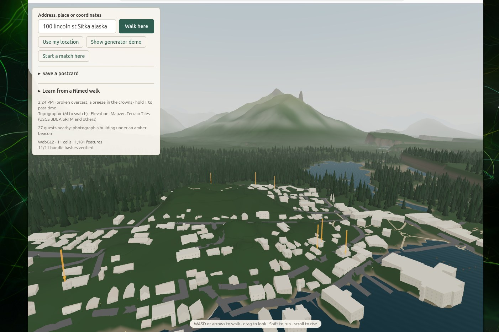

# Otherhere

A second version of where you already are: your real place, but playable, imagined, and shared. The whole Earth starts as a stylized sketch and sharpens wherever someone plays, captures, or pays attention. It's a game first, not a digital twin.



_Downtown Sitka from the harbour: every building stands where the map says it stands, at its mapped size. The forest keeps to the hills — a town is town first, and trees grow only where the data shows trees._

## Play it

**[superinstance.github.io/Otherhere](https://superinstance.github.io/Otherhere/)** — the game, straight out of this repository, no server and nothing to install. It opens on a baked snapshot of downtown Sitka (see [Baked places](#postcards-and-baked-places)) plus the generator demo. Typing a new address and building a fresh town needs the full stack below.

**On a phone, use the mobile build:** [superinstance.github.io/Otherhere/mobile](https://superinstance.github.io/Otherhere/mobile/) — the same town, drawn lighter (fewer pixels per frame, a sparser forest, coarser terrain) so it stays smooth on a small GPU. Any build takes `?lite=1` for the same profile, or `?lite=0` to force the full one. And on any screen, the panel's close button — the ✕ in its top-right corner, or the **H** key — folds the panel and the help line away entirely, so a small window can be all world; folded, a tiny ☰ waits in the screen's top-right corner to bring them back.

The full game is live at **[otherhere.superinstance.dev](https://otherhere.superinstance.dev)** and runs locally with `pnpm dev` (see [Develop](#develop)).

Controls: WASD or arrows to walk, drag to look, Shift to run, scroll (or R/F) to rise and fall. On touch screens, the left side is a joystick and the right side looks around.

## How a place gets made

Nothing here is a pre-built asset. A place is **facts plus recipes**:

1. **Facts.** OpenStreetMap is read once per area and distilled into small, attributed records — this building's footprint, its height, its roof shape, its colour — each with its source and a confidence. Facts live per H3 cell, grouped into towns.
2. **Generators.** Deterministic recipes (a geometry DSL, interpreted the same way everywhere) turn facts into buildings, roads, trees and props. Where a fact is known — a mapped height, a real roof — the geometry renders crisp and fully coloured. Where the generators have to imagine, the geometry renders **soft**: washed toward paper, with flattened shading. You can see at a glance what the world knows and what it is guessing.
3. **Bundles.** The generated geometry is packed into a GLB bundle and cached. A bundle is a pure function of its facts and generator versions, so every client re-hashes what it downloads and shows `n/n bundle hashes verified`. Refetching a place you have visited is instant; the cache is an optimisation, never the source of truth.
4. **The forest obeys the town.** Trees are not scattered by mood. Mapped trees and mapped woodland render as trees; inside a loaded town, ground the data leaves blank stays streets and lots. The wild rainforest backdrop belongs to the hills beyond the town's edge.

## Sharpening the world

The sketch is the starting point, not the product.

**Quests.** Amber beacons mark buildings whose roof, floors, or wall colour are still imagined. Photograph one and the beacon goes.

**Photos.** Tap a building to see what is known about it and where each fact came from. Add a photo: a vision model writes an observation, a question pack climbs the Ladder (cheapest judge first — TypeSafe Jev, then stronger models), and confident answers become facts with `source: "capture"`. Captures outrank OpenStreetMap, so the building redraws crisper for everyone. The photo itself is never stored. Quests are derived from facts, so every device sees the same ones — postcards included.

**Filmed walks.** Give the game a phone video and the GPS track of the same walk, and it samples frames along your route, works out which building you were facing, and runs each frame through the same photo pipeline. Buildings you passed sharpen.

## Real places, real meshes

A fact sharpens a building. A **capture** replaces it outright.

Give the game one photograph of a building and a machine on the other side of the LAN turns it
into a real 3D model — one photograph in, a textured mesh out, in about half a minute. That
mesh is a tier of the capture: fetched by its hash, verified before it is parsed, and drawn in
the building's own frame. Walk up to it and you get the true capture, a gaussian field filmed
from the street; walk away and the mesh takes over — and it is honest about the fact that it
only saw one side. St Michael's Cathedral's mesh is 169,132 B against its splat's 193,512 B.

The same lane takes a street photograph and rebuilds the _place_: the depth map becomes
geometry, the photograph is painted onto it vertex by vertex, and the result is a backdrop you
can stand in front of. It is not a reconstruction of what is behind the camera, and the docs
say so.

Both halves are measured, not asserted — [ADR-0023](docs/adr/0023-the-client-gains-a-model-tier.md)
and [ADR-0024](docs/adr/0024-a-generated-tier-is-framed-into-its-capture.md) record what was
built and what it does not do, and [`docs/proart-handoff.md`](docs/proart-handoff.md) is the
map of the two machines for anyone working on the renderer.

## Postcards and baked places

While walking a place, **Save a postcard**: you get a link holding a snapshot of the facts of the seven cells around you. Whoever opens it rebuilds the place in their own browser from that snapshot — the same town, byte for byte, a year later, with no server in the loop.

A **baked place** is a postcard shipped with the game itself. Put the snapshot at `apps/client/public/places/<name>.json` and it opens at `?place=<name>` on any build, including the serverless GitHub Pages one. The loop for improving one is the game's own loop: play the full version, sharpen the town with photos and captures, take a fresh postcard of the same cells, replace the file, push. Everyone's copy of that place gets better.

## Playing together

**Start a match here** and share the invite link: capture the flag on the real streets. Players join the smaller team and start at their bases; grab the enemy flag and bring it home; defenders tag intruders in their half. Enemies stay hidden unless a teammate is within 45 m (team fog). Motion travels peer-to-peer over WebRTC; the match's server-side referee decides pickups, captures, tags and score.

**Lend a device.** An always-on machine can run the optional plugin runtime: it pulls jobs it can run (today: fetching OpenStreetMap blocks the edge could not reach), returns proposals, and the server derives the facts itself — a plugin is never trusted with the truth. Without one, everything works as before.

## Layout

```
packages/core    zod schemas, H3 helpers, deterministic math + RNG, geometry DSL + interpreter,
                 built-in generators (JSON), GLB writer, OSM → Facts
packages/models  model router (daily budget caps), Jev / Groq / MiniMax / Claude adapters,
                 the Ladder, the photo observer
packages/judge   the fixed truth eval and scoring code, pinned by JUDGE.lock.json
apps/edge        Cloudflare Worker: TownDO (SQLite facts per town), bundle cache,
                 SessionDO (matches: signalling, relay, authoritative events), static client
apps/client      Vite + three.js (WebGPU, falls back to WebGL2): walk any lat/lng
apps/agent       optional plugin runtime (Node): pulls jobs, returns proposals the edge validates
```

Read [`docs/BRIEF.md`](docs/BRIEF.md) for the vision, [`CONTEXT.md`](CONTEXT.md) for the vocabulary, [`docs/adr/`](docs/adr) for the decisions, and [`docs/PLAN-M0.md`](docs/PLAN-M0.md) for the current milestone.

## Develop

```sh
pnpm install
pnpm dev          # client on :5173 (proxying /api) + local Worker on :8787
pnpm seed:dev     # optional: load the recorded Zürich block, so it works without reaching Overpass
open "http://localhost:5173/?at=47.3769,8.5417"
```

`?demo=generators` shows every roof shape and prop on one test lot. `?place=sitka` opens the baked Sitka snapshot. `?t=21.5` pins the hour.

```sh
pnpm test         # core (Node), edge (workerd), client unit tests
pnpm --filter @otherhere/client e2e   # Playwright: demo, real neighbourhood, pixel-identical
                                      # reload, two-player match, postcards, capture, quests
pnpm lint && pnpm typecheck
pnpm ingest <lat> <lng>               # fetch OSM around a point and summarise the facts
```

The photo pipeline needs Worker secrets: `GROQ_KEY` (vision) and `TYPESAFE_KEY` (Jev), optionally `MINIMAX_KEY` and `ANTHROPIC_API_KEY` as higher rungs. Every paid call goes through one router with daily caps per provider (`MODEL_CAPS_USD`, default $1–2/day each); spend and every Ladder decision are recorded, readable at `/api/ops/spend` and `/api/ops/decisions` with `OPS_TOKEN`. Matches behind strict NATs can relay via Cloudflare Realtime TURN (`TURN_KEY_ID`, `TURN_KEY_API_TOKEN`). Plugins authenticate with `AGENT_TOKEN`.

## Determinism

Bundles are a pure function of facts and generator versions. The demo lot's GLB hash is pinned in [`packages/core/src/demo/golden.json`](packages/core/src/demo/golden.json) and asserted in Node, in workerd, and in the browser. Hashing never depends on WebCrypto being available: on plain-http LAN origins `crypto.subtle` is withheld, so core falls back to a built-in SHA-256 held against the published test vectors — the town loads the same on a home network as it does over https. If you change generator or interpreter output on purpose, bump `INTERPRETER_VERSION` (or the generator's version) and run `pnpm --filter @otherhere/core exec tsx scripts/golden.ts`.

## Deploy

**GitHub Pages** (`.github/workflows/pages.yml`): every push to `main` builds the client with Sitka as the baked front door and deploys it to [superinstance.github.io/Otherhere](https://superinstance.github.io/Otherhere/). Static and serverless — baked places and the demo only.

**The full game** is a Cloudflare Worker that serves both the client and the API, live at [otherhere.superinstance.dev](https://otherhere.superinstance.dev). Deploy with the **Deploy** GitHub Action (repository secrets `CLOUDFLARE_API_TOKEN` — Workers Scripts edit, Workers R2 Storage edit — and `CLOUDFLARE_ACCOUNT_ID`; set the repository variable `DEPLOY_ENABLED=true` to deploy on every push to `main`), or by hand:

```sh
pnpm deploy       # builds the client, deploys the Worker (needs an R2 bucket: otherhere-bundles)
```

See [`docs/RUNBOOK.md`](docs/RUNBOOK.md) for secrets, limits, health checks, troubleshooting and rollback.

OSM data © OpenStreetMap contributors, ODbL. Fetched from public Overpass instances with endpoint fallback. Elevation: Mapzen Terrain Tiles (USGS 3DEP, SRTM and others).
